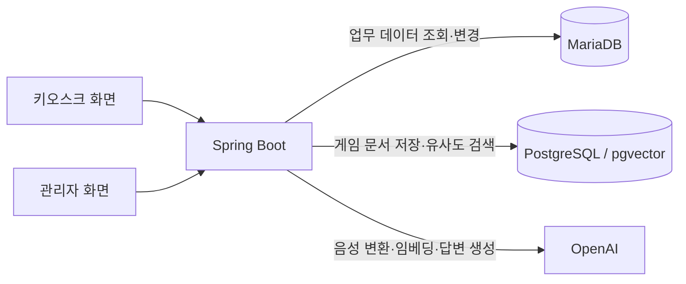

# Board Wave

보드게임 카페의 키오스크 주문과 매장 운영을 하나의 웹 시스템으로 관리하는 팀 프로젝트입니다.
고객은 테이블에서 메뉴와 게임을 주문하고, 관리자는 주문·상품·게임 재고·통계를 확인합니다.

| 항목 | 내용 |
| --- | --- |
| 팀 프로젝트 기간 | 2026.03 ~ 2026.04 |
| 참여 인원 | 4명 |
| 개발 과정 | 코리아IT아카데미 대구 응용 SW 엔지니어링 과정 |
| 본인 담당 | 로그인·추가 인증, 상품·게임 재고 관리, AI 게임 안내 |
| 프로젝트 종료 후 개인 개선 | Docker Compose 실행 환경, Flyway DB 변경 이력 관리, 문서 정리 |

개발 중 로컬과 학원 시연 환경에서 기능을 확인했습니다. 실제 배포와 별도 성능 측정은 진행하지 않았습니다.

## 주요 기능과 담당 범위

프로젝트 전체에는 키오스크 주문·결제·포인트, 테이블 이용 관리, 상품·재고 관리, 통계, WebSocket 알림, AI 게임 안내가 포함됩니다.
그중 제가 맡은 부분은 다음과 같습니다.

| 담당 영역 | 구현한 내용 |
| --- | --- |
| 로그인 | 테이블 번호 기반 키오스크 로그인과 관리자 계정 로그인을 분리 |
| 추가 인증 | `STAFF`는 등록된 이메일 주소와 입력값 비교, `ADMIN`·`SUPER`는 이메일로 발송한 OTP 확인 |
| 상품 관리 | 카테고리·메뉴·게임 등록 및 수정, 메뉴 Soft Delete와 복원 |
| 관리자 재고 관리 | 게임별 실물 일련번호 등록, 상태 관리, 재고 조회 |
| AI 게임 안내 | 음성을 텍스트로 변환하고, DB에서 관련 게임을 검색해 답변과 음성 안내 생성 |
| AI 안내 화면 | 마이크 녹음, 녹음 종료 버튼, 인식된 질문 수정, 가상 키보드 |

**관리자 화면의 실물 재고 등록·관리는 제가 맡았고, 키오스크에서 게임을 대여할 때 대여 가능 재고를 처리하는 기능은 다른 팀원이 맡았습니다.**
주문·결제·포인트·통계와 대여·반납 처리도 팀원의 담당 영역입니다.

프로젝트 종료 후에는 다른 사람이 개발 환경을 준비하기 쉽도록 Docker Compose를 추가했습니다.
DB 구조와 기준정보의 변경 이력도 관리하기 위해 Flyway를 적용했습니다. 이 작업은 팀 프로젝트 당시 기능과 구분한 개인 개선입니다.

## 기술 스택

| 구분 | 사용 기술 |
| --- | --- |
| 언어·프레임워크 | Java 21, Spring Boot 3.5.11, Spring MVC, Spring Security |
| 화면 | Thymeleaf, HTML, CSS, JavaScript |
| 데이터 접근 | MyBatis, JdbcTemplate |
| 데이터베이스 | MariaDB, PostgreSQL·pgvector |
| AI | Spring AI 1.1.4, OpenAI |
| 기타 기능 | Spring Batch, Spring WebSocket, SMTP Mail, Toss Payments |
| 개발 환경 | Gradle Wrapper, Docker Compose, Flyway |

의존성과 버전은 [build.gradle](build.gradle)에서 확인할 수 있습니다.

## 구조

하나의 Spring Boot 애플리케이션에서 키오스크와 관리자 요청을 처리합니다.
MariaDB에는 주문·상품 등 업무 데이터를, PostgreSQL의 pgvector에는 AI 검색용 문서와 벡터를 저장합니다.



AI 안내는 **질문 입력 → 관련 게임 검색 → 검색 결과를 포함한 답변 생성 → 음성 재생** 순서로 동작합니다.
이처럼 검색한 자료를 답변에 활용하는 방식을 RAG라고 합니다. 게임 정보 변경 시 검색 문서도 갱신하지만, 모든 재고 변경을 실시간으로 반영하지는 않습니다.

```text
src/main/java/org/example/board_cafe_kiosk_2603
├── ai             # AI 안내, 게임 문서 생성·검색
├── config         # Security, DB, Flyway 등 설정
├── controller     # 관리자·키오스크 요청 처리
├── domain / dto   # 도메인 객체와 요청·응답 데이터
├── mapper         # MyBatis 인터페이스
├── security       # 사용자 조회, 로그인 성공 처리, 인가
├── service        # 비즈니스 로직
└── scheduler / websocket

src/main/resources
├── db/migration   # MariaDB·pgvector Flyway SQL
├── mapper         # MyBatis XML
├── static         # CSS, JavaScript
└── templates      # Thymeleaf 화면
```

## 로컬 실행 방법

DB는 Docker Compose로 실행하고, Spring Boot는 호스트 PC에서 실행합니다.
새 환경에서의 실행은 추가 확인이 필요합니다. 테스트 준비 상태는 [Testing](docs/testing.md), 외부 공개 전 점검 사항은 [Known Issues](docs/known-issues.md)를 참고해 주세요.

### 1. 실행 환경과 설정 파일 준비

- JDK 21
- Docker Desktop 또는 Docker Engine과 Compose
- OpenAI API 키: 현재 AI 클라이언트 구성에 필요
- 메일 인증을 확인할 경우 SMTP 계정, 결제를 확인할 경우 Toss Payments 키

프로젝트 루트에서 예시 파일을 복사합니다. 기존 설정 파일이 있다면 새로 덮어쓰지 않고 내용을 확인합니다.

```bash
cp .env.example .env
cp .env.compose.example .env.compose
```

| 파일 | 설정할 내용 |
| --- | --- |
| [.env.example](.env.example)을 복사한 `.env` | `OPENAI_API_KEY`, `RAG_REINDEX_ON_STARTUP`, 필요한 메일·결제 설정 |
| [.env.compose.example](.env.compose.example)을 복사한 `.env.compose` | 두 DB의 계정, 비밀번호, 호스트 포트 |

`.env.compose`의 예시 비밀번호 세 개는 최초 DB 생성 전에 변경합니다.
`compose` 프로필에서는 DB 접속에 `.env.compose` 값을 사용합니다. `.env.example`의 일반 DB 접속값과 구분합니다.
두 파일은 Git 제외 대상입니다.

시작 시 게임 임베딩을 실행하려면 `.env`의 `RAG_REINDEX_ON_STARTUP=true`를 사용합니다.
이 과정은 OpenAI API를 호출합니다. DB 설치만 먼저 확인하려면 `false`로 설정할 수 있습니다.
`false`는 시작 시 임베딩만 건너뛰는 설정으로, AI 클라이언트 설정이나 이후 AI 요청까지 비활성화하지는 않습니다.

### 2. DB와 애플리케이션 실행

```bash
docker compose --env-file .env.compose up -d --wait
./gradlew bootRun --args='--spring.profiles.active=compose'
```

Windows에서는 Gradle 명령을 다음과 같이 실행합니다.

```powershell
.\gradlew.bat bootRun --args="--spring.profiles.active=compose"
```

IntelliJ에서 실행한다면 JDK를 21로 설정하고, 프로젝트 루트를 작업 디렉터리로 사용하며 Active profiles에 `compose`를 지정합니다.
접속 주소는 [http://localhost:8080](http://localhost:8080)입니다.

### 3. 초기화 흐름과 확인할 내용

[docker-compose.yml](docker-compose.yml)은 DB와 계정을 생성하고, 애플리케이션의 `compose` 프로필이 Flyway 마이그레이션을 활성화합니다.
새 DB를 기준으로 다음 파일을 적용하는 구성입니다.

| DB | 마이그레이션 |
| --- | --- |
| MariaDB | [V1: 업무·Batch 스키마](src/main/resources/db/migration/mariadb/V1__create_schema.sql), [V2: 기준정보](src/main/resources/db/migration/mariadb/V2__insert_reference_data.sql) |
| PostgreSQL | [V1: 벡터 저장소 스키마](src/main/resources/db/migration/pgvector/V1__create_vector_schema.sql) |

기준정보 SQL에는 게임 6종과 실물 재고 12개 등이 포함되어 있습니다. 주문·결제·매출 이력은 생성하지 않습니다.
기존 스키마가 있는 DB에 자동으로 맞춰 주는 구성은 아니므로, 처음 설치할 때는 이 프로젝트용 새 DB를 사용합니다.

실행 후에는 DB 연결·마이그레이션 완료 여부와 시작 시 임베딩 결과를 각각 확인해야 합니다.
임베딩 실패를 로그로 남기고 앱 실행을 계속하는 코드가 있으므로, 서버 기동만으로 AI 검색 준비까지 완료됐다고 판단하지 않습니다.
테스트 실행 조건과 누락된 검증 자료는 [Testing](docs/testing.md)에 정리했습니다.

## 설계와 문제 해결 기록

| 구분 | 문서 | 설명할 내용 |
| --- | --- | --- |
| ADR 001 | [키오스크·관리자 인증 분리](docs/adr/001-authentication-design.md) | 서로 다른 로그인 흐름을 나눈 이유 |
| ADR 002 | [메뉴 Soft Delete](docs/adr/002-menu-soft-delete.md) | 과거 통계 조회에 필요한 메뉴 정보 유지 |
| ADR 003 | [RAG 데이터 동기화](docs/adr/003-rag-synchronization.md) | 운영 DB의 변경을 검색 문서에 반영하는 방식 |
| 문제 해결 001 | [음성 녹음 종료 방식 변경](docs/troubleshooting/001-voice-recording.md) | 시연 환경의 잡음에 대응한 입력 방식 변경 |
| 문제 해결 002 | [신규 게임 재고 집계](docs/troubleshooting/002-game-stock-count.md) | 신규 등록 게임이 집계되지 않았던 경험 |
| 문제 해결 003 | [RAG 검색 기준 조정](docs/troubleshooting/003-rag-similarity.md) | 임베딩 저장 확인 후 검색 기준을 조정한 과정 |
| 인증 구현 기록 | [추가 인증과 SecurityContext](docs/troubleshooting/004-security-context.md) | 추가 인증 전후의 인증 상태 처리 |
| 현황 | [Known Issues](docs/known-issues.md) | 현재 한계와 개선 우선순위 |
| 검증 | [Testing](docs/testing.md) | 테스트 범위, 실행 조건, 수동 확인과 미검증 항목 |
